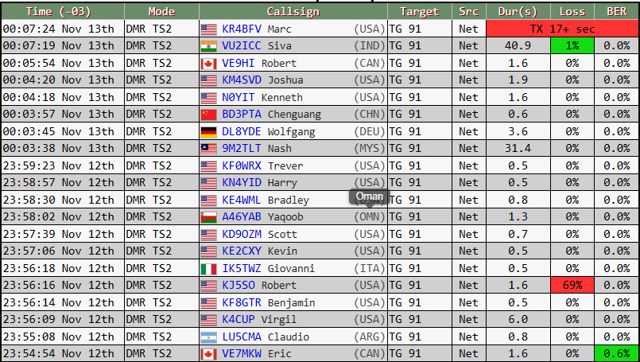

**Portugues** | [English](README.en.md)

# pistar-flags-dash

Mostra a bandeira do pais, o nome do operador e o codigo do pais (com o nome
por extenso ao passar o mouse) na lista *Last Heard* do dashboard do
**Pi-Star oficial** - de um jeito leve o suficiente pra rodar num
Raspberry Pi Zero W.



Cada linha ganha a bandeira do pais, o nome do operador e o codigo do pais em
3 letras (ex.: `(BRA)`, `(USA)`, `(IND)`). Passando o mouse no codigo, aparece
o nome do pais por extenso - no idioma do dashboard.

---

## Por que isso existe

Eu rodo meu hotspot num Raspberry Pi Zero W (ARMv6, single-core). Queria deixar
o dashboard mais informativo - bandeira do pais, nome de quem esta falando -
igual aos dashboards "turbinados" que a gente ve por ai.

O caminho natural seria instalar o WPSD (W0CHP-PiStar-Dash), que e excelente e
tem tudo isso embutido. So que o proprio autor do WPSD avisa, com todas as
letras, que ele NAO foi feito pra hardware fraco como o Pi Zero W - roda lento
e pesado nesse tipo de placa. E e verdade: o WPSD calcula e exibe muita coisa
em tempo real, o que e demais pro Pi Zero.

Eu nao queria o pacote inteiro. Queria so tres coisas: bandeira, nome e pais.
Entao, em vez de trocar de hardware ou sofrer com um dashboard lento, fiz este
patch minimo: ele adiciona exatamente essas informacoes ao dashboard OFICIAL do
Pi-Star, sem o peso de um fork completo.

Resumindo: se voce esta na mesma situacao que eu - Pi-Star oficial, hardware
modesto (Pi Zero W e afins), e so quer bandeira + nome + pais sem trocar o
dashboard inteiro - este projeto e pra voce.

> AVISO: e so pra o Pi-Star OFICIAL. Se voce ja usa WPSD ou outro fork, nao
> precisa disto (eles ja tem essa funcionalidade). O instalador detecta forks
> e aborta sem mexer em nada.

---

## O que ele faz

- Bandeira do pais ao lado do indicativo (derivada do prefixo, tabela de
  prefixos ITU - cobertura mundial, mais de 230 paises e territorios).
- Nome do operador (lido do `DMRIds.dat`, a mesma base que o Pi-Star ja baixa).
- Codigo do pais em 3 letras no lugar do antigo link "(GPS)" - que levava pro
  aprs.fi e, na pratica, nao servia pra muita coisa. Ex.: `(BRA)`, `(USA)`.
- Tooltip com o nome do pais por extenso, no idioma do dashboard: se o Pi-Star
  esta em ingles mostra "Brazil"; em portugues, "Brasil".
- Deixa a coluna *Time* um pouco mais estreita, sobrando espaco pro indicativo.
- Adiciona uma linha de credito no rodape do dashboard:
  `Flags, names & country codes: pistar-flags-dash by PP5RD (...)`.

### Por que e leve (importa no Pi Zero)

- A bandeira e uma imagem SVG estatica servida pelo proprio webserver - custo
  de CPU praticamente zero.
- O `DMRIds.dat` (~6-7 MB) e lido uma unica vez e os pares indicativo -> nome
  ficam num cache em disco, refeito so quando o arquivo muda. Nos refreshes de
  1,5 s, le-se o cache - nao o arquivo inteiro.
- O resto (pais, codigo, tooltip) e resolvido em memoria, sem rede.

Ou seja: nada do processamento pesado que torna os forks completos lentos no
Pi Zero.

---

## Instalacao

### 1. Antes de tudo: faca um backup da sua configuracao

No dashboard, va em **Configuration -> Backup/Restore** e baixe o backup (um
arquivo `.zip`). Guarde esse arquivo no seu computador.

Este patch nao mexe na configuracao do hotspot, mas qualquer mexida no Pi-Star
merece um backup antes. Se algo der errado, voce restaura o zip na mesma pagina.
Atencao: o proprio Pi-Star avisa que senhas de sistema/dashboard NAO vao no
backup (WiFi e senhas das redes DMR vao).

### 2. Instale

No seu hotspot, via SSH:

```bash
cd /tmp
git clone https://github.com/danielregis81/pistar-flags-dash.git
cd pistar-flags-dash
sudo ./install.sh
```

Depois, Ctrl+F5 no dashboard (hard refresh pra limpar o cache do navegador).

**Por que `cd /tmp` primeiro?** O disco do Pi-Star e somente-leitura, inclusive
a sua pasta pessoal (`/home/pi-star`). Se voce rodar o `git clone` ali, vai dar
`Read-only file system`. O `/tmp` fica na memoria e aceita escrita, entao e la
que o clone deve ficar. O instalador cuida sozinho de liberar a escrita no
disco so durante a instalacao.

**Atencao:** o `/tmp` e apagado quando o Pi reinicia. A instalacao em si
continua (ela e gravada no disco), mas a pasta clonada some. Pra desinstalar ou
atualizar depois de um reboot, rode o `cd /tmp` e o `git clone` de novo.

### Comandos

```bash
sudo ./install.sh              # instala (ou atualiza)
sudo ./install.sh --status     # mostra o estado atual
sudo ./install.sh --uninstall  # remove e restaura o dashboard original
```

O instalador cuida de tudo:
- detecta o dashboard e aborta se for um fork (WPSD etc.);
- monta o sistema de arquivos como leitura/escrita (`rpi-rw` se existir, senao
  `mount -o remount,rw /`) e volta pra somente-leitura ao terminar - inclusive
  se der erro ou se a instalacao for interrompida (Ctrl+C, SSH caiu);
- faz backup do `lh.php` original antes de qualquer mudanca;
- aplica o patch de forma nao-destrutiva (injeta so o necessario, nao troca o
  arquivo) e valida a sintaxe com `php -l`;
- instala a reaplicacao automatica pos-update (veja abaixo).

### O que e instalado e onde

| Onde | O que |
|------|-------|
| `/var/www/dashboard/mmdvmhost/lh.php` | recebe o patch (o original fica em `lh.php.bak-flags`) |
| `/var/www/dashboard/mmdvmhost/lh_enrich.php` | funcoes de pais, nome e tooltip |
| `/var/www/dashboard/images/flags/` | bandeiras SVG |
| `/usr/local/share/lh-flags-patch/` | pasta propria do projeto: copia dos arquivos e o script de reaplicacao |
| `/etc/cron.hourly/zz-pistar-lh-reapply` | gatilho da reaplicacao a cada hora |

Nada e gravado na configuracao do hotspot (`/etc/mmdvmhost`, `/etc/dmrgateway`
etc.). O script de reaplicacao fica na pasta propria do projeto, fora das
pastas que o Pi-Star controla por git (`/usr/local/sbin`, `/usr/local/bin`).
Versoes antigas deste projeto colocavam esse script em `/usr/local/sbin`; o
instalador atual remove de la automaticamente.

---

## Sobrevive aos updates do Pi-Star

O dashboard do Pi-Star e um repositorio git, e um `pistar-update` pode reverter
o `lh.php`. Pra isso nao derrubar a customizacao, o projeto instala um
`cron.hourly` que reaplica o patch sozinho caso detecte que ele sumiu. Quando
nao ha nada a fazer, ele sai na hora, sem tocar no disco.

---

## Desinstalacao

```bash
sudo ./install.sh --uninstall
```

Restaura o `lh.php` original (do backup), remove as bandeiras, o
`lh_enrich.php`, o script de reaplicacao e o cron. Ctrl+F5 depois.

---

## Limitacoes (sendo honesto)

- Nome vem do `DMRIds.dat` (base DMR). Indicativos que nao estiverem nessa base
  aparecem so com a bandeira - sem nome. Nenhum erro, so nao tem o dado.
- Bandeira/pais dependem do prefixo do indicativo (tabela ITU). Cobre a grande
  maioria, mas se aparecer um prefixo nao mapeado a linha fica sem bandeira (sem
  quebrar nada). PRs de novos prefixos sao bem-vindos.
- Pensado e testado no Pi-Star oficial (v4.2.6, Pi Zero W). Nao testei em todas
  as versoes/forks - e em forks ele nem instala, de proposito.

---

## Estrutura

```
pistar-flags-dash/
|- install.sh               # instala / desinstala / status
|- lib/patch-lh.sh          # patch nao-destrutivo e idempotente do lh.php
|- src/
|  |- lh_enrich.php         # funcoes: pais (ITU), nome (DMRIds+cache), tooltip
|  \- flags/                # bandeiras SVG (ISO-3166-1 alpha-2) + INDEX
|- pistar-lh-reapply        # reaplicacao pos-update
|- cron/zz-pistar-lh-reapply # gatilho cron.hourly
|- docs/screenshot.png
|- README.md                # este arquivo (portugues)
|- README.en.md             # versao em ingles
\- LICENSE                  # GPL-3.0
```

---

## Creditos

- Andy Taylor (MW0MWZ) - criador do Pi-Star, que tornou tudo isso possivel.
- Hampus Borgos - [country-flags](https://github.com/hampusborgos/country-flags),
  as bandeiras SVG (dominio publico).
- A ideia de bandeira por indicativo e inspirada em forks do Pi-Star (como o
  WPSD/W0CHP) e em projetos como o `xlxd`.

Este NAO e um projeto oficial do Pi-Star. Use por sua conta e risco.

## Licenca

GPL-3.0 - veja [LICENSE](LICENSE). O Pi-Star e GPL; este e um trabalho derivado
e segue a mesma licenca.
